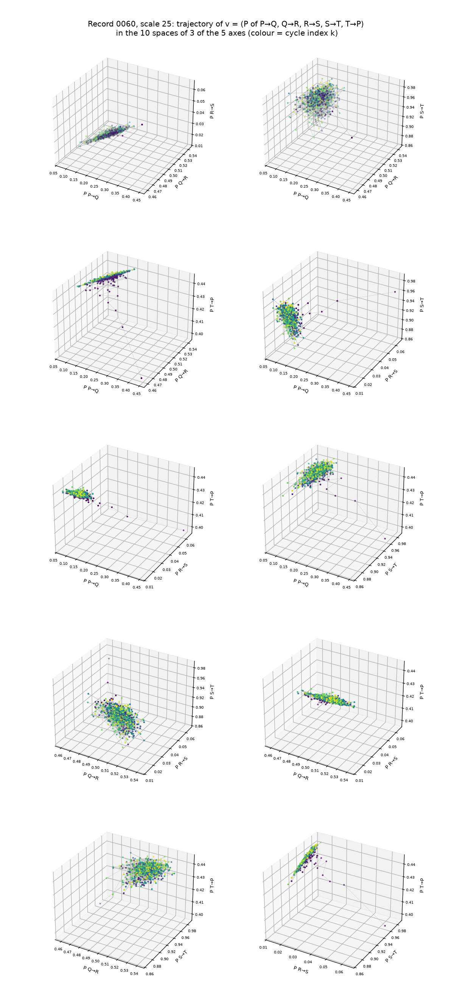

# Complexity

Each cycle k is one point in the 5-axis probability space:

v_k = (P of P→Q, Q→R, R→S, S→T, T→P), with every P in [0, 1].

From cycle to cycle the point moves, and its trajectory forms a cloud. The complexity of the
heart is the room this cloud takes in the probability space:

- **dimension** — the participation ratio (Σλ)² / Σλ², where λ are the eigenvalues of the covariance of v: how many directions the cycle moves in (1 to 5).
- **spread** — the median and 95 % distance of v from the centre of the cloud: how far it moves.

The first 20 cycles (the learning phase) are left out of both measures.

## Record 0060 (PhysioNet Autonomic Aging, first-order scale 25)



*The trajectory of v in the 10 spaces of 3 of the 5 axes. Colour = cycle index k.*

After the learning phase the cycle stays in one small, flat cloud: dimension 1.88, spread 0.022
(median) and 0.049 (95 %). It moves mostly along P→Q and S→T; T→P and R→S almost stay fixed.
All values are in [`complexity.csv`](complexity.csv).

## Hypothesis

Disease and aging are associated with a loss of complexity of physiological dynamics, toward
excessive regularity or toward uncorrelated randomness
([Goldberger et al. 2002, PNAS 99:2466](https://doi.org/10.1073/pnas.012579499)). In this space,
the first would shrink the cloud, the second would spread it into all five axes. This is a
hypothesis, not tested here.

## Usage

```bash
python complexity/trajectory_3d.py aging 0060 25
```

Reads `aging/data/cycles_0060_scale25.csv` (from `scripts/cycle_vectors.py`), writes the figure
here and adds the record to `complexity.csv`. Requires numpy, pandas, matplotlib.
